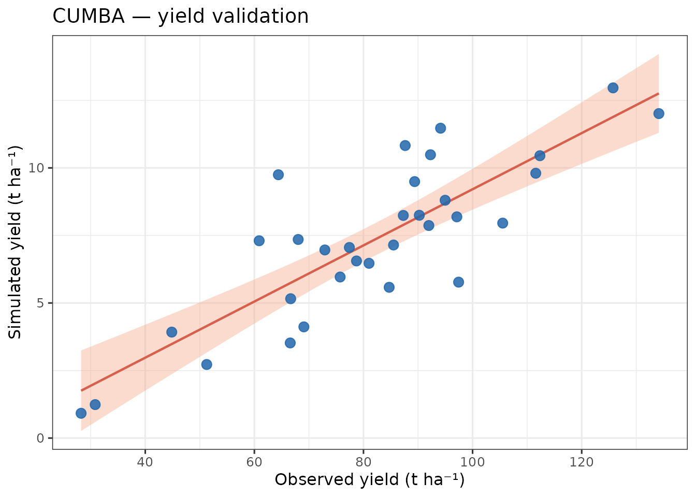
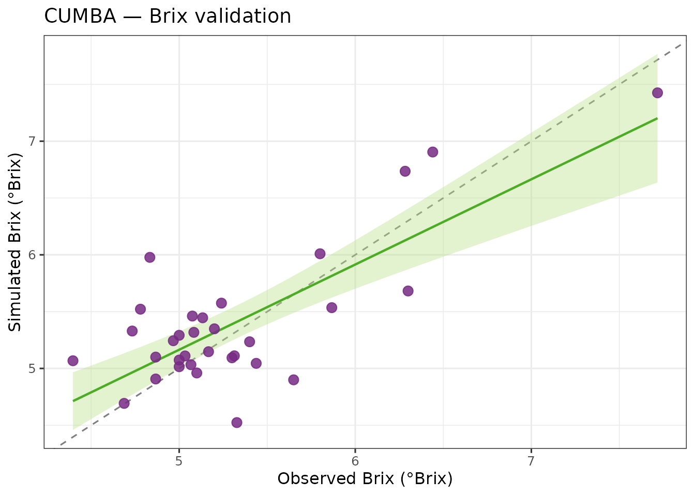

# Run an experiment with cumba_experiment()

## When to use `cumba_experiment()`

Use
[`cumba_experiment()`](https://GeoModelLab.github.io/cumba/reference/cumba_experiment.md)
when you have **observed experiments** with their actual irrigation
schedule and you want CUMBA to reproduce them. This is the function used
during **model calibration** against yield/Brix observations.

The companion function
[`cumba_scenario()`](https://GeoModelLab.github.io/cumba/reference/cumba_scenario.md)
is meant for *what-if* deficit-irrigation studies, where irrigation is
triggered automatically based on phase-specific water-stress thresholds.

## Required inputs

| Argument               | Description                                                                                 |
|------------------------|---------------------------------------------------------------------------------------------|
| `weather`              | Daily data frame: `Site`, `Tx`, `Tn`, `P`, `DATE`, `Lat` (if `estimateRad = TRUE`) or `Rad` |
| `param`                | Named list-of-lists (e.g. `cumbaParameters`) or plain numeric data frame                    |
| `irrigation_df`        | Data frame with `ID`, `Site`, `YEAR`, `DATE`, `WVOL` (mm)                                   |
| `estimateRad`          | `TRUE` → Hargreaves–Samani from `Lat`; `FALSE` → use `Rad` column                           |
| `estimateET0`          | `TRUE` → FAO-56 Penman–Monteith; `FALSE` → use `ET0` column                                 |
| `irrigationEfficiency` | Fraction of applied water reaching the root zone (default `0.9`)                            |
| `fullOut`              | `FALSE` → short output; `TRUE` → all internal state variables                               |

## A complete walkthrough on `tomatoFoggia`

``` r
library(cumba)
library(dplyr)
library(ggplot2)

data(tomatoFoggia)
data(cumbaParameters)

out <- cumba_experiment(
  weather              = tomatoFoggia$weather,
  param                = cumbaParameters,
  irrigation_df        = tomatoFoggia$irrigation,
  estimateRad          = TRUE,
  estimateET0          = TRUE,
  irrigationEfficiency = 0.9,
  fullOut              = FALSE
)

head(out)
#>     site year experiment doy p irrigation              stage      swc yield
#> 1 Foggia 2005          1 118 0       27.9 post-transplanting 30.00000     0
#> 2 Foggia 2005          1 119 0        0.0 post-transplanting 29.78431     0
#> 3 Foggia 2005          1 120 0        0.0 post-transplanting 29.60447     0
#> 4 Foggia 2005          1 121 0        0.0 post-transplanting 29.40442     0
#> 5 Foggia 2005          1 122 0        0.0 post-transplanting 29.28403     0
#> 6 Foggia 2005          1 123 0        0.0 post-transplanting 29.23520     0
#>   brix
#> 1    0
#> 2    0
#> 3    0
#> 4    0
#> 5    0
#> 6    0
```

### Harvest-day values

Each simulation ends when the crop cycle is complete. The last row for
each (site × year × experiment) combination carries the harvest-day
yield and Brix:

``` r
harvest <- out |>
  group_by(site, year, experiment) |>
  slice_tail(n = 1) |>
  ungroup() |>
  select(site, year, experiment, yield, brix)

harvest
#> # A tibble: 32 × 5
#>    site    year experiment yield  brix
#>    <chr>  <dbl>      <dbl> <dbl> <dbl>
#>  1 Foggia  2005          1  41.2  6.01
#>  2 Foggia  2005          2  82.4  5.35
#>  3 Foggia  2005          3 108.   5.07
#>  4 Foggia  2005          4  64.7  5.29
#>  5 Foggia  2005          5  70.5  5.15
#>  6 Foggia  2005          6  94.9  5.09
#>  7 Foggia  2006          7  35.2  5.98
#>  8 Foggia  2006          8  65.6  5.24
#>  9 Foggia  2006          9  81.9  5.33
#> 10 Foggia  2006         10  55.8  5.23
#> # ℹ 22 more rows
```

### Compare with observations

`tomatoFoggia$production` contains observed `yield_ref` (t ha⁻¹) and
`brix_ref` (°Brix). The `yield` column in the short output is in **q
ha⁻¹**, so divide by 10 to convert to t ha⁻¹:

``` r
production <- tomatoFoggia$production

cmp <- harvest |>
  mutate(experiment = as.integer(experiment)) |>
  inner_join(production, by = c("experiment" = "ID")) |>
  mutate(yield_t = yield / 10)

ggplot(cmp, aes(yield_ref, yield_t)) +
  geom_abline(slope = 1, intercept = 0, linetype = 2, colour = "grey50") +
  geom_smooth(method = "lm", se = TRUE, colour = "#d6604d",
              fill = "#f4a582", linewidth = 0.8) +
  geom_point(size = 3, colour = "#2166ac", alpha = 0.85) +
  labs(x = "Observed yield (t ha⁻¹)",
       y = "Simulated yield (t ha⁻¹)",
       title = "CUMBA — yield validation") +
  theme_bw(base_size = 12)
```



``` r

ggplot(cmp, aes(brix_ref, brix)) +
  geom_abline(slope = 1, intercept = 0, linetype = 2, colour = "grey50") +
  geom_smooth(method = "lm", se = TRUE, colour = "#4dac26",
              fill = "#b8e186", linewidth = 0.8) +
  geom_point(size = 3, colour = "#762a83", alpha = 0.85) +
  labs(x = "Observed Brix (°Brix)",
       y = "Simulated Brix (°Brix)",
       title = "CUMBA — Brix validation") +
  theme_bw(base_size = 12)
```



### Full output for diagnostics

Pass `fullOut = TRUE` to access every internal state variable (GDD, Kc,
soil water per layer, carbon pools, flowering state, etc.):

``` r
out_full <- cumba_experiment(
  weather              = tomatoFoggia$weather,
  param                = cumbaParameters,
  irrigation_df        = tomatoFoggia$irrigation,
  estimateRad          = TRUE,
  estimateET0          = TRUE,
  fullOut              = TRUE
)

names(out_full)
```

## Notes

- Cardinal temperatures in `param` must satisfy `Tmax > Topt > Tbase`
  and soil parameters must satisfy `FieldCapacity > WiltingPoint`;
  otherwise the function stops with a descriptive error.
- Run-time scales linearly with the number of (site × year × ID)
  combinations: each is simulated independently day-by-day.
- The `experiment` column in the output is a character; convert with
  [`as.integer()`](https://rdrr.io/r/base/integer.html) before joining
  with integer-keyed observation tables.
