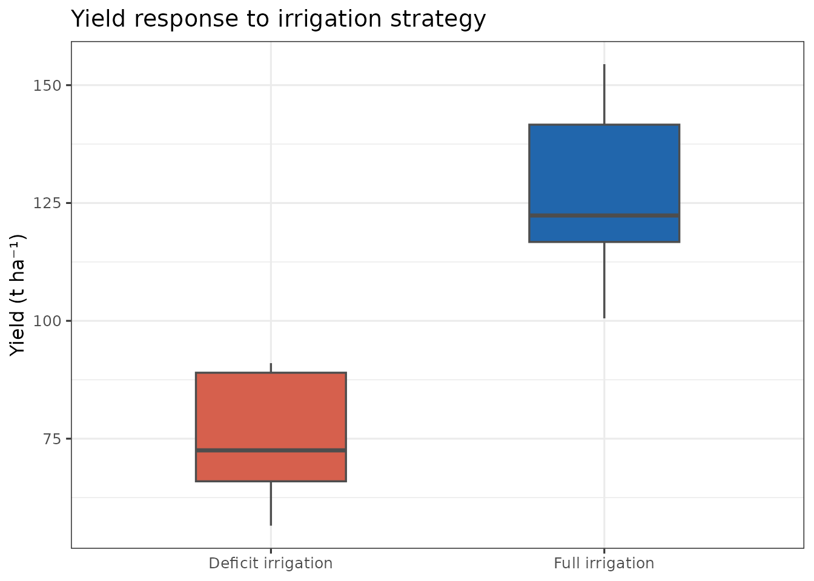
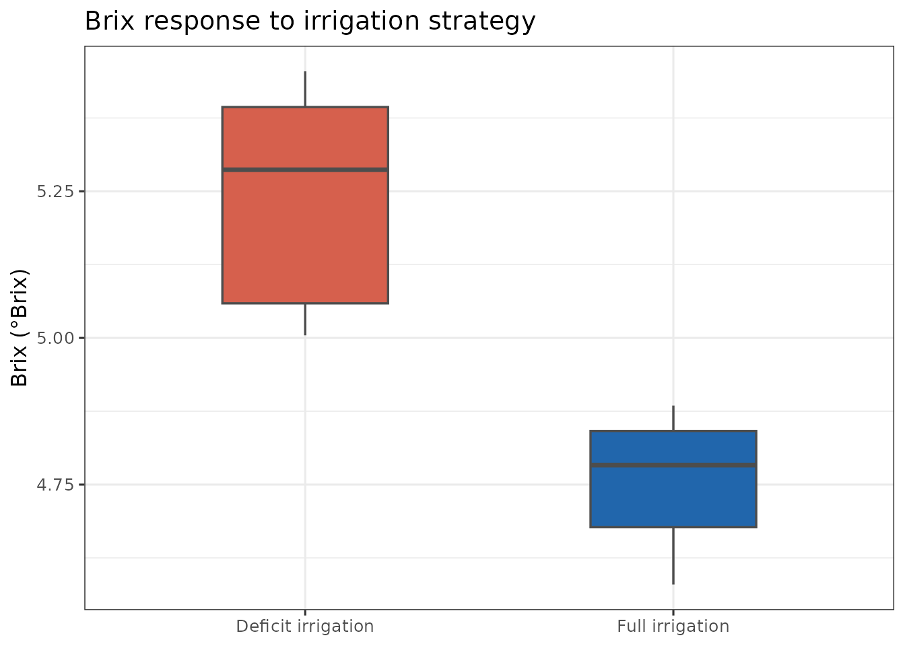
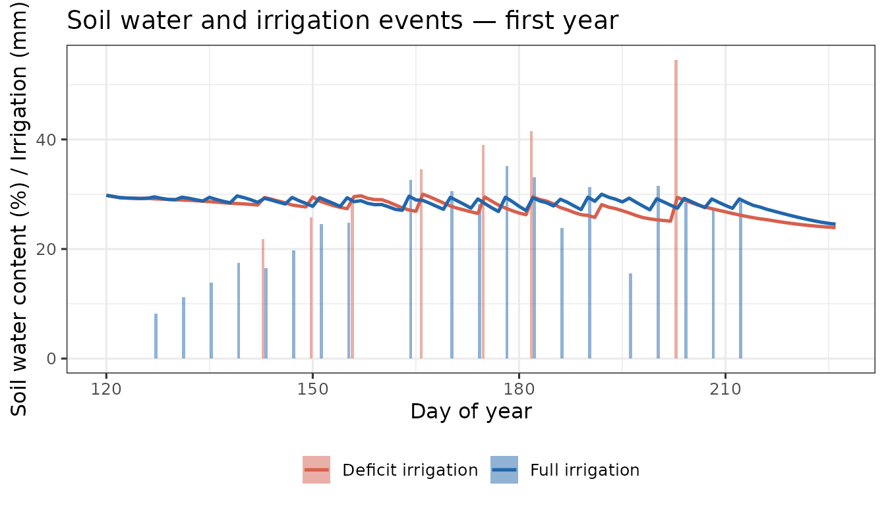

# Run a deficit-irrigation scenario with cumba_scenario()

## Why `cumba_scenario()`?

While
[`cumba_experiment()`](https://GeoModelLab.github.io/cumba/reference/cumba_experiment.md)
replays an observed irrigation schedule,
[`cumba_scenario()`](https://GeoModelLab.github.io/cumba/reference/cumba_scenario.md)
runs the model in **automatic deficit-irrigation mode**. Irrigation is
triggered when, simultaneously:

1.  the crop water status (`ws = 1 - WSI`, where WSI is the simulated
    water-stress index) falls **below a phase-specific threshold**
    (`wsLevel`), and
2.  at least `turnMin` days have elapsed since the last irrigation.

The water applied at each event refills the soil to field capacity in
the rooted layers.

## The `irrigationStrategy` argument

The irrigation logic is controlled by a single **`irrigationStrategy`**
argument — a named list with one entry per phenological phase:

| Phase          | Period                    |
|----------------|---------------------------|
| `vegetative`   | transplanting → flowering |
| `reproductive` | flowering → mid-ripening  |
| `ripening`     | mid-ripening → harvest    |

Each entry is a list with:

- `wsLevel` — threshold (0–1) on the crop water status `ws = 1 - WSI`.
  Irrigation fires when `ws < wsLevel`, i.e. when WSI exceeds
  `1 - wsLevel`.
- `turnMin` — minimum days between consecutive irrigations.

## A complete walkthrough on `tomatoFoggia`

``` r
library(cumba)
library(dplyr)
library(ggplot2)

data(tomatoFoggia)
data(cumbaParameters)

weather <- tomatoFoggia$weather

out <- cumba_scenario(
  weather          = weather,
  param            = cumbaParameters,
  estimateRad      = TRUE,
  estimateET0      = TRUE,
  transplantingDOY = 120,
  irrigationStrategy = list(
    vegetative   = list(wsLevel = 0.5, turnMin = 4),
    reproductive = list(wsLevel = 0.5, turnMin = 4),
    ripening     = list(wsLevel = 0.5, turnMin = 4)
  ),
  fullOut = FALSE
)

head(out)
#>     site year experiment doy p irrigation              stage      swc yield
#> 1 Foggia 2005          1 120 0          0 post-transplanting 29.80184     0
#> 2 Foggia 2005          1 121 0          0 post-transplanting 29.58283     0
#> 3 Foggia 2005          1 122 0          0 post-transplanting 29.37420     0
#> 4 Foggia 2005          1 123 0          0 post-transplanting 29.30290     0
#> 5 Foggia 2005          1 124 0          0 post-transplanting 29.25984     0
#> 6 Foggia 2005          1 125 0          0 post-transplanting 29.22264     0
#>   brix
#> 1    0
#> 2    0
#> 3    0
#> 4    0
#> 5    0
#> 6    0
```

### Compare two irrigation strategies

Define a full-irrigation and a deficit strategy, then compare yield and
Brix at harvest across all site-years:

``` r
full_irr <- list(
  vegetative   = list(wsLevel = 1.0, turnMin = 4),
  reproductive = list(wsLevel = 1.0, turnMin = 4),
  ripening     = list(wsLevel = 1.0, turnMin = 4)
)

deficit <- list(
  vegetative   = list(wsLevel = 0.4, turnMin = 4),
  reproductive = list(wsLevel = 0.4, turnMin = 4),
  ripening     = list(wsLevel = 0.3, turnMin = 4)
)

run_strategy <- function(strategy, label) {
  cumba_scenario(
    weather            = weather,
    param              = cumbaParameters,
    irrigationStrategy = strategy,
    transplantingDOY   = 120,
    estimateRad        = TRUE,
    estimateET0        = TRUE,
    fullOut            = FALSE
  ) |>
    mutate(strategy_label = label)
}

scen <- bind_rows(
  run_strategy(full_irr, "Full irrigation"),
  run_strategy(deficit,  "Deficit irrigation")
)

# Last row per (strategy × site × year) = harvest day
harvest <- scen |>
  group_by(strategy_label, site, year) |>
  slice_tail(n = 1) |>
  ungroup()

pal <- c("Full irrigation" = "#2166ac", "Deficit irrigation" = "#d6604d")

ggplot(harvest, aes(strategy_label, yield, fill = strategy_label)) +
  geom_boxplot(width = 0.45, outlier.shape = 21, outlier.size = 2,
               colour = "grey30", linewidth = 0.6) +
  scale_fill_manual(values = pal) +
  labs(y = "Yield (t ha⁻¹)", x = NULL,
       title = "Yield response to irrigation strategy") +
  theme_bw(base_size = 12) +
  theme(legend.position = "none")
```



``` r

ggplot(harvest, aes(strategy_label, brix, fill = strategy_label)) +
  geom_boxplot(width = 0.45, outlier.shape = 21, outlier.size = 2,
               colour = "grey30", linewidth = 0.6) +
  scale_fill_manual(values = pal) +
  labs(y = "Brix (°Brix)", x = NULL,
       title = "Brix response to irrigation strategy") +
  theme_bw(base_size = 12) +
  theme(legend.position = "none")
```



### Daily soil-water and irrigation dynamics

``` r
scen_yr1 <- scen |> filter(year == min(year))

ggplot(scen_yr1, aes(doy)) +
  geom_col(aes(y = irrigation, fill = strategy_label),
           position = "dodge", width = 0.9, alpha = 0.5) +
  geom_line(aes(y = swc, colour = strategy_label), linewidth = 0.9) +
  scale_colour_manual(values = pal, name = NULL) +
  scale_fill_manual(values = pal, name = NULL) +
  labs(x = "Day of year",
       y = "Soil water content (%) / Irrigation (mm)",
       title = "Soil water and irrigation events — first year") +
  theme_bw(base_size = 12) +
  theme(legend.position = "bottom")
```



## Notes

- [`cumba_scenario()`](https://GeoModelLab.github.io/cumba/reference/cumba_scenario.md)
  does **not** require an `irrigation_df`; the schedule is generated
  internally from the stress thresholds.
- The `yield` column in the short output is in **t ha⁻¹**.
- Setting `fullOut = TRUE` returns all internal state variables (Kc,
  carbon pools, flowering state, soil water per layer, etc.).
- The `irrigationStopCycle` argument (default `100`) sets the
  phenological cycle completion percentage beyond which no further
  irrigation is applied — useful for regulated-deficit ripening.
