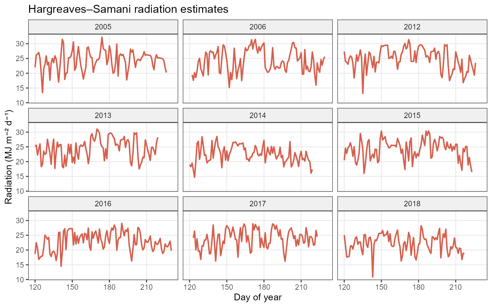
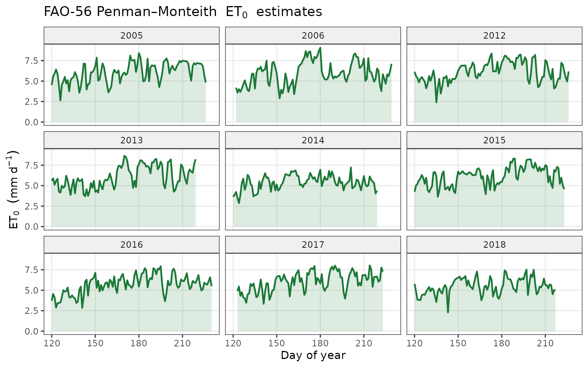

# Internal radiation and ET₀ estimators

## Overview

[`cumba_scenario()`](https://GeoModelLab.github.io/cumba/reference/cumba_scenario.md)
and
[`cumba_experiment()`](https://GeoModelLab.github.io/cumba/reference/cumba_experiment.md)
can internally estimate two key driving variables from basic weather
inputs:

- **Solar radiation** — Hargreaves–Samani formula, requiring only daily
  Tmax, Tmin, and site latitude (`estimateRad = TRUE`).
- **Reference evapotranspiration ET₀** — a temperature-based
  approximation of the FAO-56 Penman–Monteith equation, requiring Tmax,
  Tmin, and latitude (`estimateET0 = TRUE`).

This vignette runs the model in scenario mode over all years in
`tomatoFoggia` and inspects the seasonal behaviour of both estimators.

## Load data and run the model

``` r

library(cumba)
library(dplyr)
library(ggplot2)
library(lubridate)

data(tomatoFoggia)
data(cumbaParameters)

weather_obs <- tomatoFoggia$weather

# Run over all site-years; fullOut = TRUE exposes radiation and et0 columns
out <- cumba_scenario(
  weather          = weather_obs,
  param            = cumbaParameters,
  estimateRad      = TRUE,
  estimateET0      = TRUE,
  transplantingDOY = 120,
  irrigationStrategy = list(
    vegetative   = list(wsLevel = 0.5, turnMin = 4),
    reproductive = list(wsLevel = 0.5, turnMin = 4),
    ripening     = list(wsLevel = 0.5, turnMin = 4)
  ),
  fullOut = TRUE
)
#> CUMBA running in deficit irrigation mode
#> 🍅 running experiment  1  in site  Foggia  and year  2005 
#> 🍅 running experiment  2  in site  Foggia  and year  2006 
#> 🍅 running experiment  3  in site  Foggia  and year  2012 
#> 🍅 running experiment  4  in site  Foggia  and year  2013 
#> 🍅 running experiment  5  in site  Foggia  and year  2014 
#> 🍅 running experiment  6  in site  Foggia  and year  2015 
#> 🍅 running experiment  7  in site  Foggia  and year  2016 
#> 🍅 running experiment  8  in site  Foggia  and year  2017 
#> 🍅 running experiment  9  in site  Foggia  and year  2018 
#> 

sim <- out |> select(year, doy, radiation, et0)
glimpse(sim)
#> Rows: 936
#> Columns: 4
#> $ year      <dbl> 2005, 2005, 2005, 2005, 2005, 2005, 2005, 2005, 2005, 2005, …
#> $ doy       <dbl> 120, 121, 122, 123, 124, 125, 126, 127, 128, 129, 130, 131, …
#> $ radiation <dbl> 21.97549, 26.14867, 26.52642, 27.02956, 24.94472, 19.90342, …
#> $ et0       <dbl> 4.498681, 5.590547, 5.928367, 6.417341, 5.884589, 4.454225, …
```

## Radiation estimates — seasonal dynamics

The Hargreaves–Samani method approximates solar radiation from the daily
temperature range, which correlates with cloud cover. The estimates
track the expected bell-shaped seasonal pattern for a Mediterranean site
at latitude ~41°N.

``` r

ggplot(sim, aes(doy, radiation)) +
  geom_line(colour = "#d6604d", linewidth = 0.8) +
  facet_wrap(~year, ncol = 3) +
  labs(
    x     = "Day of year",
    y     = "Radiation (MJ m⁻² d⁻¹)",
    title = "Hargreaves–Samani radiation estimates"
  ) +
  theme_bw(base_size = 11) +
  theme(
    strip.background = element_rect(fill = "#f0f0f0"),
    panel.grid.minor = element_blank()
  )
```



## ET₀ estimates — seasonal dynamics

The temperature-based ET₀ follows the same seasonal trajectory as
radiation, rising through summer and falling toward harvest. Values in
the 4–9 mm d⁻¹ range are typical for Foggia in June–August.

``` r

ggplot(sim, aes(doy, et0)) +
  geom_area(fill = "#1b7837", alpha = 0.15) +
  geom_line(colour = "#1b7837", linewidth = 0.8) +
  facet_wrap(~year, ncol = 3) +
  labs(
    x     = "Day of year",
    y     = expression(ET[0]~~(mm~d^{-1})),
    title = expression("FAO-56 Penman–Monteith"~~ET[0]~~"estimates")
  ) +
  theme_bw(base_size = 11) +
  theme(
    strip.background = element_rect(fill = "#f0f0f0"),
    panel.grid.minor = element_blank()
  )
```



## Summary statistics by year

``` r

sim |>
  group_by(year) |>
  summarise(
    n_days           = n(),
    mean_rad         = round(mean(radiation, na.rm = TRUE), 1),
    max_rad          = round(max(radiation,  na.rm = TRUE), 1),
    mean_et0         = round(mean(et0,       na.rm = TRUE), 1),
    season_total_et0 = round(sum(et0,        na.rm = TRUE), 0)
  ) |>
  rename(
    Year                        = year,
    `Days simulated`            = n_days,
    `Mean radiation (MJ m⁻² d⁻¹)` = mean_rad,
    `Max radiation (MJ m⁻² d⁻¹)`  = max_rad,
    `Mean ET₀ (mm d⁻¹)`                = mean_et0,
    `Season total ET₀ (mm)`                      = season_total_et0
  )
#> # A tibble: 9 × 6
#>    Year `Days simulated` `Mean radiation (MJ m⁻² d⁻¹)` Max radiation (MJ m⁻² d…¹
#>   <dbl>            <int>                         <dbl>                     <dbl>
#> 1  2005              107                          24.4                      32.2
#> 2  2006              108                          24.1                      31.5
#> 3  2012              107                          24.9                      31.4
#> 4  2013              100                          24.5                      31.1
#> 5  2014              100                          22.5                      28.5
#> 6  2015              104                          24.2                      30.4
#> 7  2016              111                          23                        29.1
#> 8  2017              101                          23.9                      28.9
#> 9  2018               98                          22.2                      28.2
#> # ℹ abbreviated name: ¹​`Max radiation (MJ m⁻² d⁻¹)`
#> # ℹ 2 more variables: `Mean ET₀ (mm d⁻¹)` <dbl>, `Season total ET₀ (mm)` <dbl>
```
